

  

    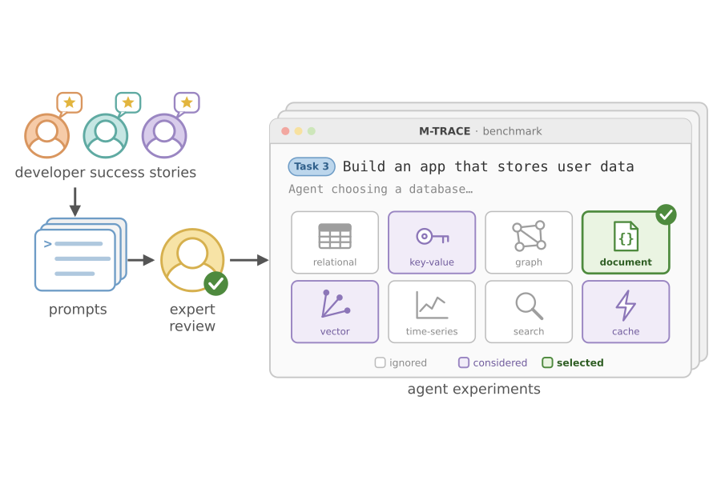
    

      

        M-TRACE: Human-grounded benchmark for evaluating frontier coding agent behavior
      

      

        Built and validated M-TRACE (MongoDB Tasks for Real-world Agentic Capability Evaluation), a benchmark grounded in real developer problems to evaluate whether frontier coding agents make infrastructure decisions the way developers would. Validated prompt quality using LLM judges calibrated against domain expert ground truth — expert-grounded judges outperformed vanilla judges on failure detection across three criteria (realism, commonality, and neutrality), reaching >90% agreement; agentic experiments established the org's first real-world baseline for how agents consider and select technology on developers' behalf.
      

    

  

  

    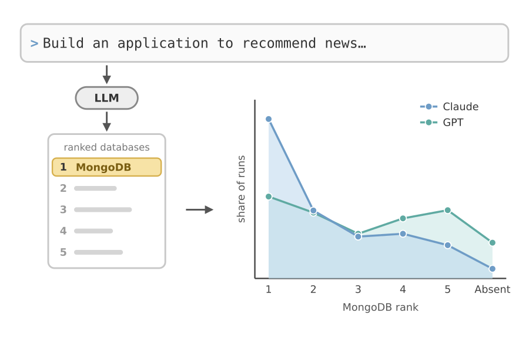
    

      

        LLM infrastructure bias: How frontier coding agents discover and select databases
      

      

        Designed and executed a study with 8,000+ LLM simulations to test whether frontier coding models recommend databases the way real developers do — as LLMs increasingly mediate developer decisions, systematic bias in their recommendations has direct consequences for what gets built. Found that model architecture and assigned persona drive awareness, preference ranking, and selection outcomes across identical prompts. Research established the org-wide standard practice for human evaluation of coding agents at MongoDB and directly informed developer advocacy and model partnership strategy.
      

    

  

  

    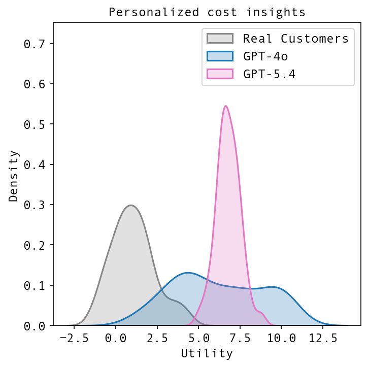
    

      

        LLM-as-respondent: Can AI simulate developer preferences?
      

      

        Ran the first empirical test of whether LLMs can substitute for real users in preference research — teams increasingly use synthetic respondents to inform AI product decisions, making validity of LLM-generated feedback a consequential open question. Compared AI-generated MaxDiff (best-worst scaling) survey responses (4 persona conditions × 3 temperature settings × 3 model versions) against real user data via KL divergence and Spearman correlation. Found weak to moderate rank correlation between LLM and real user responses, with AI systematically skewing toward cost over performance optimization across all models, persona conditions, and temperature settings; presented to senior leadership and directly influenced the org's AI evaluation governance.
      

    

  

  

    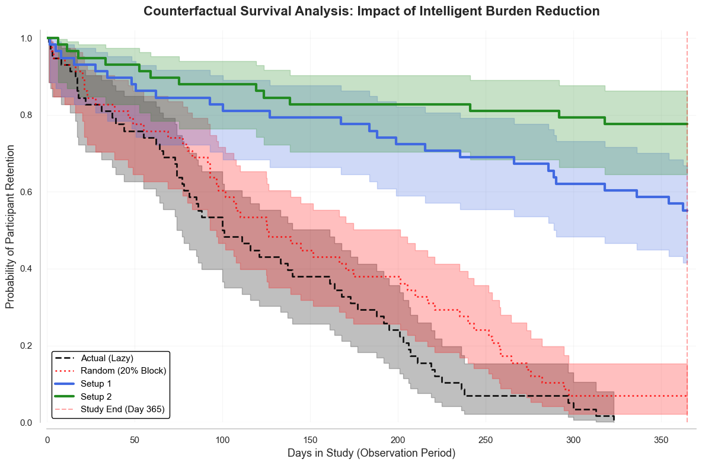
    

      

        Context-aware model for experience sampling
      

      

        Developed neural network models predicting optimal survey timing in longitudinal experience sampling studies using multimodal wearable sensor data — addressing the fundamental tension between data quality and participant burden in real-world behavioral research. Training on multimodal user context outperforms random interruption by >40% in F1; for cold-start personalization, population breadth works better for engaged users while longitudinal depth works better for disengaged users. Counterfactual survival analysis shows the model would have improved long-term study retention; under review at ACM IMWUT.
      

    

  

 
  

    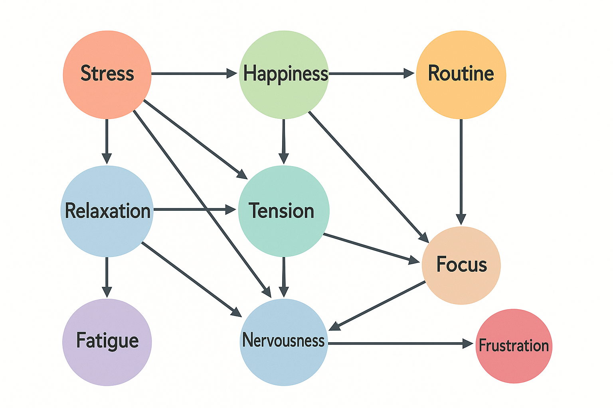
    

      

        Personalized experience sampling surveys
      

      

        Developed ML approaches for real-time survey question personalization in longitudinal studies — predicting non-response bias with mixed-effects models and maximizing information gain per question using Bayesian Networks. Motivated by redundant questions that burden participants without improving data quality in long-running studies; demonstrated >34% reduction in mean survey length and >15% reduction in imputation errors for missing data across multiple longitudinal studies without compromising data quality.
      

    

  

  
  
  

    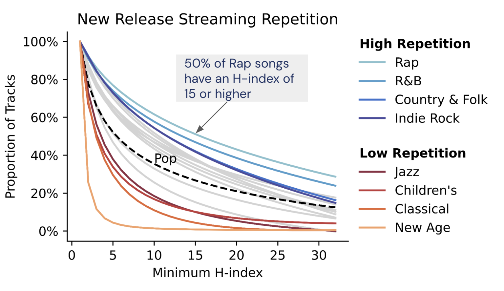
    

      

        User modeling of new music listening
      

      

        Built large-scale predictive models of new music listening behavior using 2M+ user-release interaction logs — finding that new music engagement is exploratory rather than confirmatory, but users have consistent individual listening diets ranging from highly exploratory to more confirmatory. Insights directly informed Spotify Home A/B tests, achieving a 14% increase in engagement with new music recommendations. [Read more](https://research.atspotify.com/2024/05/how-do-people-stream-newly-released-music/)
      

    

  

  
  

    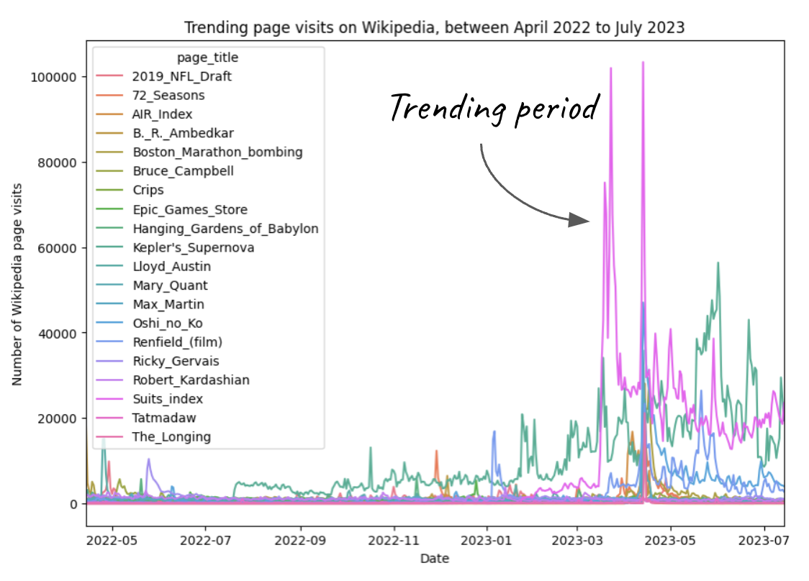
    

      

        AI-enabled podcast content understanding
      

      

        Built a trending topic detection system mining human behavioral signals — Spotify search queries and Wikipedia page views — to surface culturally relevant long-tail podcasts that standard recommendation algorithms miss. For topic-to-podcast matching, LLM embedding-based cosine similarity outperformed zero-shot prompting; causal analysis showed trending topic alignment increases long-tail podcast user engagement by ~10%; adopted by three product teams focused on music and podcast discovery on Spotify Home.
      

    

  

  
  

    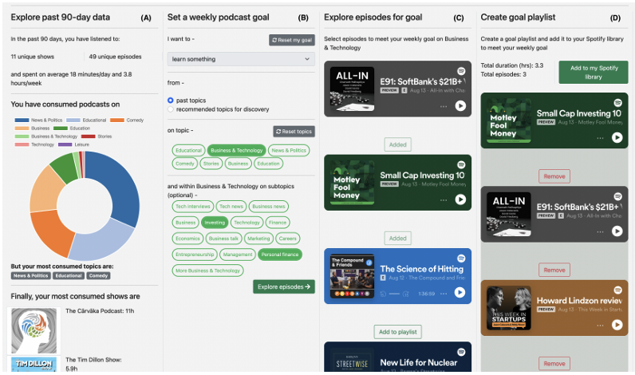
    

      

        Podcast discovery via goal-setting
      

      

        How does user input improve discovery? Built an interactive AI prototype (inspired by Strava/Duolingo) where users set goals to receive personalized podcast recommendations. Used large-scale event-triggered surveys and search queries to identify user needs, revealing a gap between long-term goals (e.g., learning) and short-term entertainment needs. Real-world evaluation showed that goal-setting helped users discover new podcasts. [Read more](https://research.atspotify.com/2023/03/exploring-goal-oriented-podcast-recommendations/)
      

    

  

    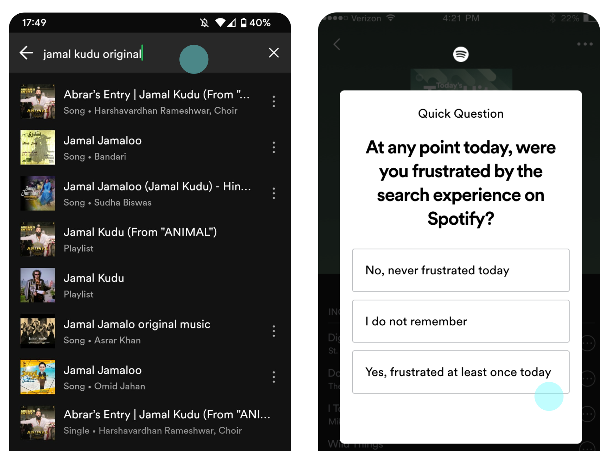
    

      

        Measuring search user frustration
      

      

        Developed an ML model predicting search frustration from user behavioral signals — finding query edit distance as the strongest predictor — using event-triggered intercept surveys deployed at the moment of likely frustration as human-labeled ground truth. Revealed that standard search success metrics masked significantly worse experiences for international users; deployed in Spotify production A/B tests where the metric provided causal explanation for why 2-step search outperformed instant search.
      

    

  

  

    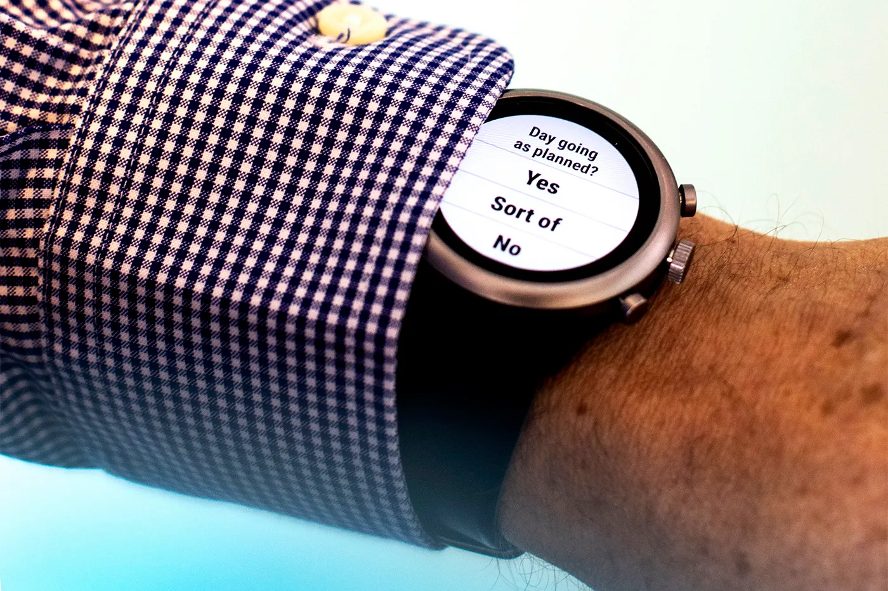
    

      

        MicroEMA: Experience sampling via smartwatch microinteractions
      

      

        Invented a smartwatch-based experience sampling method redesigning longitudinal surveys as binary microinteractions to optimize high-frequency self-report collection — addressing the burden and attrition that limit traditional EMA in real-world behavioral research. Achieved 2x response rates versus standard smartphone surveys while significantly lowering participant burden across year-long longitudinal studies; adopted in multiple NIH-funded studies and industry. [Read more](https://news.northeastern.edu/2019/09/05/northeastern-university-professor-combines-computer-science-with-health-and-measurement-with-self-reporting-to-improve-accuracy-of-fitness-tracking/)
      

    

  

  

    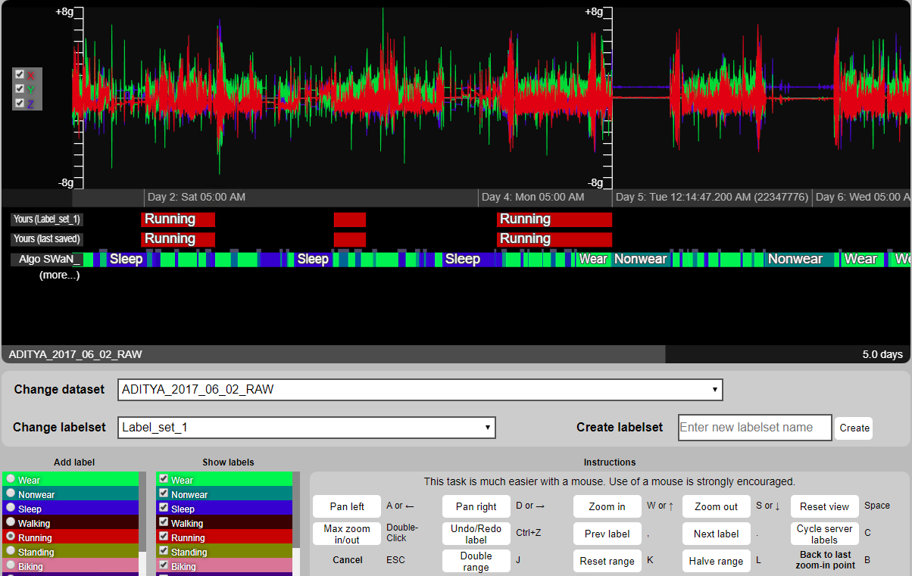
    

      

        Signaligner Pro: AI-assisted sensor data labeling
      

      

        How can we make data labeling scalable and reliable for ML? Built Signaligner Pro, an open-source, AI-assisted tool for labeling wearable sensor data at scale. The system supports efficient annotation of activities such as walking and running by combining human-in-the-loop precision with automated model suggestions. Signaligner Pro is now used in multiple NIH-funded studies, for high-quality label generation and supporting the development of more robust and generalizable ML models through human–AI collaboration. [Try it here](https://signaligner.org/)
      

    

  

  

    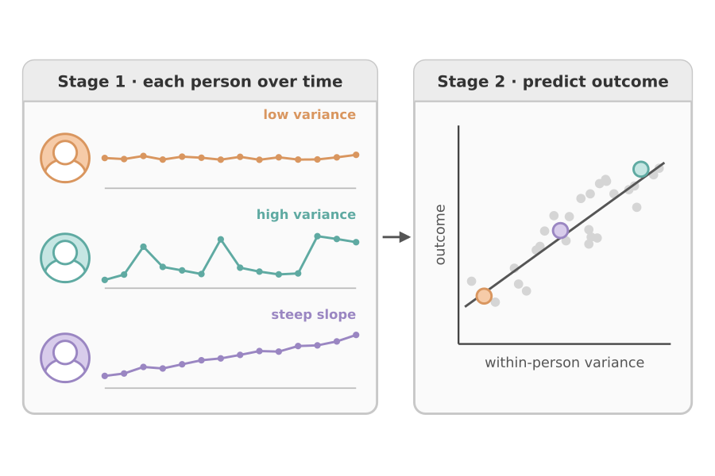
    

      

        MixWILD: Interactive mixed-effects modeling
      

      

        What if we could build statistical models without coding? MixWILD is an open-source modeling tool for intensive longitudinal data that estimates individual differences in both mean levels and variability of time-varying processes (like change in stress levels), including random slopes. It uses mixed-effects location-scale models and second-stage analyses to examine how within-person variability and change relate to predictors and outcomes. [Try it here](https://reach-lab.github.io/MixWildGUI/)
      

    

  

  

    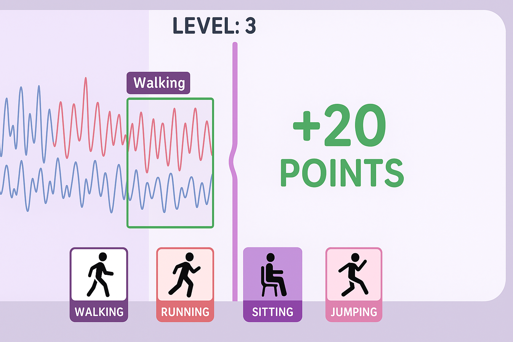
    

      

        Video games for human data labeling
      

      

        Designed two video games for crowdsourced labeling of wearable sensor data — routing the expert annotation bottleneck in ML training data pipelines through human play behavior at scale. Found that puzzle-based game designs outperform endless runner designs for label accuracy; directly led to the development of Signaligner Pro. [VentureBeat coverage](https://web.archive.org/web/20221006042815/https://venturebeat.com/ai/how-video-games-could-be-used-to-generate-ai-training-data/)
      

    

  

  

    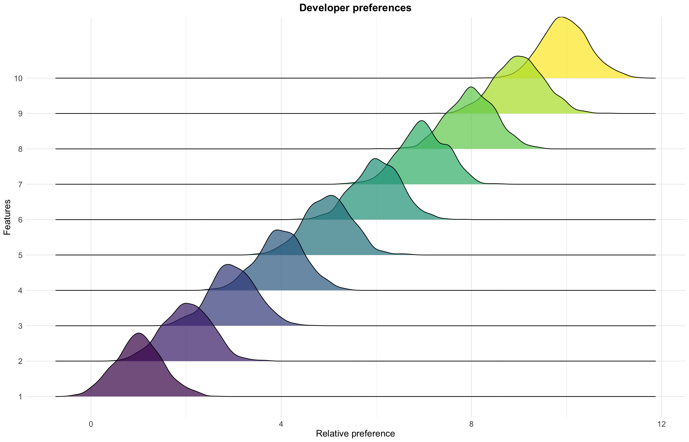
    

      

        Modeling developer preferences
      

      

        What do developers care about most? We used discrete choice models to study developer preferences for MongoDB Atlas through large-scale MaxDiff surveys. The surveys captured trade-offs between cost and performance, revealing clear differences between novice and experienced developers. These insights informed A/B experiments for personalized developer experiences, leading to > 8% improvement in user engagement and task success.
      

    

  

 
  

    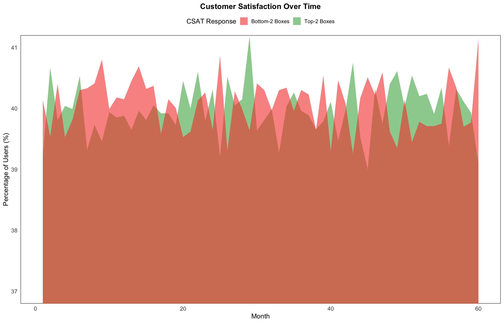
    

      

        UX metrics for developer experiences
      

      

        How do we measure the success of design changes? We developed new UX metrics to evaluate the MongoDB Atlas experience at scale, including measures of developer sentiment, engagement, and task success. These metrics were used to assess design changes across observability, identity and access management, and billing interfaces, providing a scalable, data-driven framework for cross-functional teams.
      

    

  

  

<!-- 

    
    
    
    
    

    
Text 1

    
Text 2

    
Text 3

    
Text 4

    
Text 5

 -->

